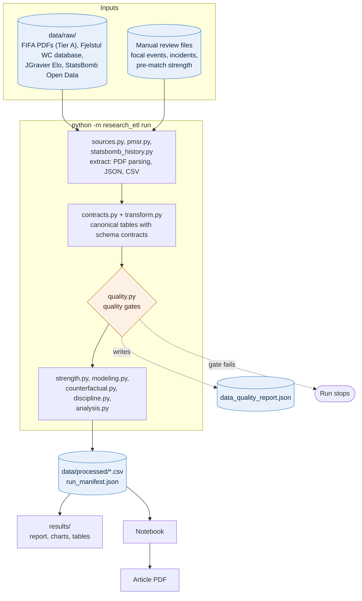

# Argentina Comeback Analysis

**How rare was Argentina's 3-2 comeback win over Egypt (0-2 down with ~10 minutes left) in the 2026 FIFA World Cup Round of 16 — and does the evidence support the "Argentina is FIFA's golden child" narrative?**

A reproducible, evidence-tiered statistical and counterfactual research project. Every claim is source-linked, every probability is reported with its sample size and uncertainty interval, and every officiating-related result is explicitly labelled conditional/exploratory rather than a finding of bias — see [`Project.md`](Project.md) for the full research contract and evidentiary rules this project holds itself to.

## Start here

- **[`results/analysis_report.md`](results/analysis_report.md)** — the full write-up with all charts, numbers, denominators, and caveats. Start here if you want the findings without running any code.
- **[`output/jupyter-notebook/argentina_egypt_comeback_analysis.ipynb`](output/jupyter-notebook/argentina_egypt_comeback_analysis.ipynb)** — the executable notebook. Runs top-to-bottom from a clean kernel against the data already committed in this repo.
- **[`Project.md`](Project.md)** — the research specification: estimands, evidence tiers, bias controls, and the interpretation rules every result in this repo follows.

## What's in this repo

| Path | Contents |
| --- | --- |
| `data/raw/` | Vendored source data: FIFA Performance Summary PDFs (focal match + Argentina's 2026 matches), Fjelstul World Cup Database (1930-2022), JGravier Elo ratings |
| `data/processed/` | Canonical, notebook-ready tables produced by the ETL pipeline, including the compact StatsBomb-derived club/international event and snapshot tables (2,379 matches, extracted from StatsBomb Open Data — see `config/sources.json:statsbomb_history`) |
| `data/reference/` | Small, version-controlled seed inputs (manual review templates and compact source-linked extracts) |
| `src/research_etl/` | The ETL/analysis package: extraction, transformation, quality gates, counterfactual simulation, discipline statistics, model validation |
| `tests/` | Test suite (`pytest`) covering every analytical module |
| `results/` | Generated analysis outputs: the write-up, charts, and machine-readable result tables |
| `config/sources.json` | Full data provenance — URLs, pinned commits, license notes, extraction methodology for every source |

## System Design

The project is a small, contract-driven ETL and analysis system. Its design goal is that every number in the report can be traced to a tiered source, a quality gate, and a test.

### Requirements

**Functional**
- Estimate the historical rarity of late two-goal comebacks, the match-state win probability while Argentina trailed 0–2, and the sensitivity to disputed officiating decisions.
- Produce a report, charts, machine-readable result tables, and an executable notebook.

**Non-functional**
- **Evidence tiers**: Tier A (official FIFA records) to Tier D (reporting); lower tiers can raise claims but cannot establish them.
- **Reproducibility**: vendored raw data, pinned source commits, and run manifests; the notebook runs from a clean kernel against committed data.
- **Honest uncertainty**: every probability carries its sample size and an interval; conflicting estimators are both reported.

### Pipeline Architecture



### Key Design Choices

- **Contracts before analysis.** Each canonical table has a declared schema; a failed quality gate stops the run instead of producing a partial result.
- **Independent cross-validation sample.** A 2,193-match StatsBomb club-football sample checks World Cup-only rarity and probability estimates against an unrelated data source.
- **No composite "bias index".** Officiating results are reported as conditional, decision-level sensitivities, never aggregated into a single advantage score.
- **Manual inputs are explicit files.** Human-reviewed events and incidents live in `data/raw/manual/` and are versioned like any other source.

### Trade-offs

| Decision | Benefit | Cost |
| --- | --- | --- |
| Vendored raw data in Git | Fully offline, reproducible runs | Larger repository |
| Two match-state estimators reported side by side | No cherry-picking | Less tidy headline number |
| Descriptive discipline statistics | Avoids unsupported causal claims | Cannot adjust for possession, style, or opponent quality |

### What to Revisit as It Grows

- Add an event-level possession and style model before testing any officiating-bias hypothesis.
- Package the ETL as a reusable "match rarity" toolkit with configurable focal matches.

## Reproducing the analysis

```powershell
uv sync --extra notebook
uv run --project . python -m research_etl run       # extract -> transform -> validate -> analyze
uv run --project . --extra notebook jupyter execute output/jupyter-notebook/argentina_egypt_comeback_analysis.ipynb
uv run --project . --extra notebook pytest
```

## Headline findings (see the [full report](results/analysis_report.md) for denominators, methods, and caveats)

- **Zero** comparable two-goal, late-game comebacks in 964 men's World Cup matches (1930-2022) at any pre-registered threshold minute — robust across four different era slices, and cross-validated against a fully independent 2,193-match club-football sample (2 comebacks found — a ~1-in-300-to-1-in-700 rate, still solidly rare, not literally zero).
- Argentina's own modelled win probability while 0-2 down is genuinely uncertain: two legitimate estimation methods disagree by an order of magnitude in the 66'-80' window, both reported rather than cherry-picked — though the World-Cup-only numbers are corroborated to within ~1 percentage point by the independent club-football dataset.
- A conditional (non-decision-correctness) sensitivity check shows a disputed disallowed goal would have been a materially meaningful (3-5 percentage point) swing — explicitly not a claim the officiating decision was wrong.
- Argentina's elevated penalty/card rates in 2022 and its penalty-awarded lead in 2026 are real, descriptive, and directionally consistent — but not unique to 2022 (1958, 1982, 1990 show equal-or-higher rates on the same metrics) and not adjusted for the confounds (possession, playing style, opponent quality) that would be required to call this evidence of bias.

## Data sources and licensing

See [`config/sources.json`](config/sources.json) for the complete provenance record (source URLs, retrieval dates, pinned commits, and license notes) of every dataset used. Historical data is from the [Fjelstul World Cup Database](https://github.com/jfjelstul/worldcup) (CC-BY-SA-4.0) and [JGravier/soccer-elo](https://github.com/JGravier/soccer-elo) (CC-BY-4.0); focal-match and 2026 tournament data is drawn from official FIFA Performance Summary Reports (Tier A).
