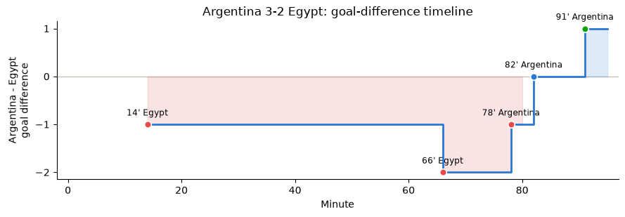
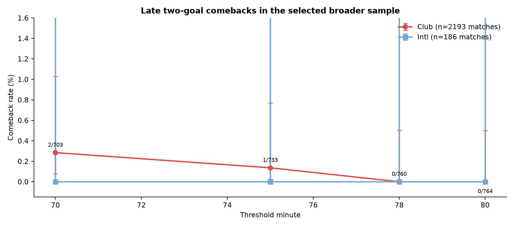
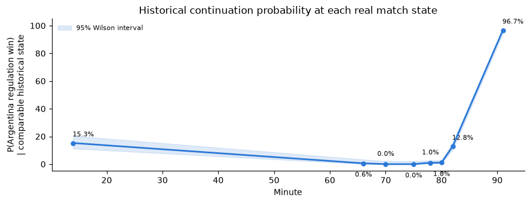
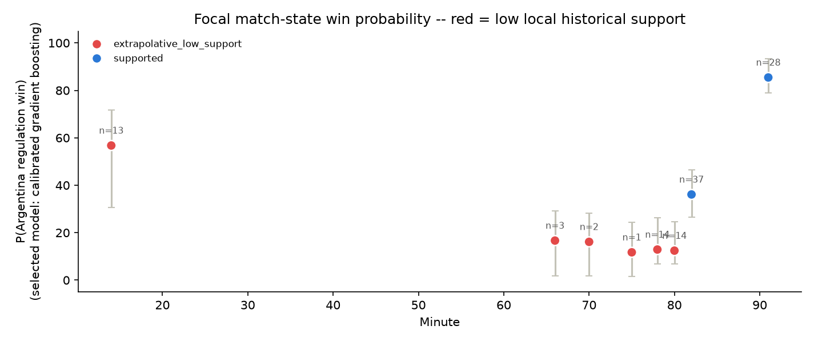
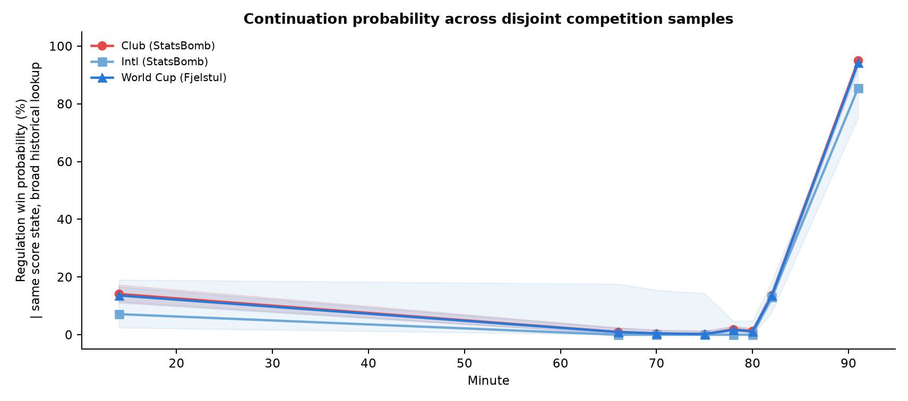
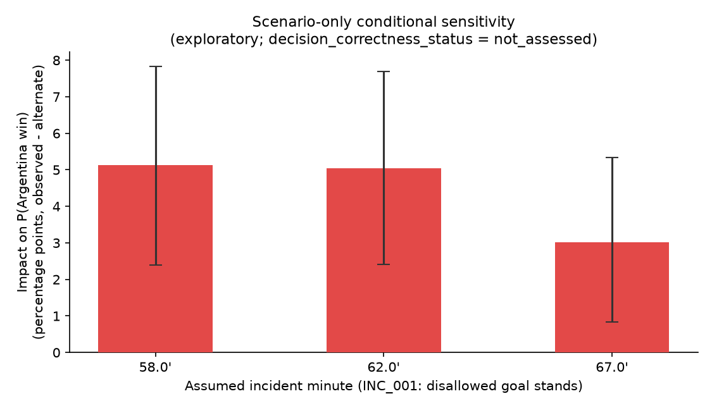
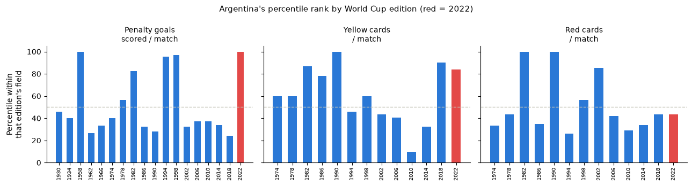
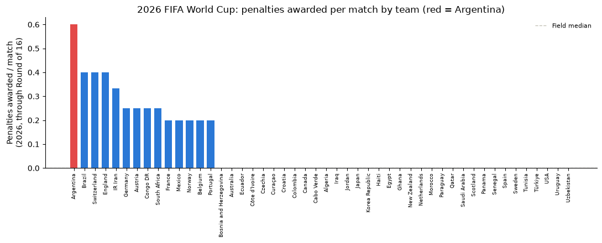

# How Rare Was Argentina's Comeback Against Egypt?

**A statistical and counterfactual analysis of Argentina 3-2 Egypt, FIFA World Cup 2026 Round of 16 (Atlanta Stadium, 7 July 2026)**

*Generated from `output/jupyter-notebook/argentina_egypt_comeback_analysis.ipynb`, executed against the current `data/processed/` and `results/` artifacts. The compact StatsBomb tables are reproducible with `uv run --project . python -m research_etl run --with-statsbomb-history` after fetching the pinned raw cache; the remaining figures use the standard run followed by a top-to-bottom notebook execution.*

---

## Executive summary

Argentina trailed Egypt 0-2 with roughly ten minutes of regulation time left and won 3-2. Two independent questions are addressed separately, per this project's own rules (`Project.md`), and are **not** combined into a single verdict:

1. **How rare was this, statistically?** Very rare among comparable historical matches — but the sample of matches that ever reached this exact state is small, and the answer changes depending on how "comparable" is defined.
2. **Does the evidence support a claim of favorable officiating toward Argentina, in this match or since 2022?** No single result here proves or disproves that. Every quantitative check below is either (a) a raw descriptive count with known confounds, or (b) an explicitly conditional "if this alternate decision had been made" sensitivity analysis with `decision_correctness_status = not_assessed`. None of it should be read as a finding of bias, corruption, or manipulation.

**What is genuinely well-supported:** the comeback was extraordinarily rare within the World Cup record (0 comparable comebacks in 964 matches across 22 tournaments, at every pre-registered threshold minute) and remains rare — roughly 1-in-300-to-1-in-700, not literally zero — when cross-checked against a selected 2,193-match sample of club football. The disjoint club sample agrees with the World Cup continuation curve within one percentage point from minutes 66' through 82', but the minute-91 difference is 1.7 points and the sample is availability-selected rather than a census of club football. **What is genuinely uncertain:** the specific win-probability at each match-state once strength is conditioned on, because those states have almost no comparable historical matches to estimate from (as few as one). **What is exploratory:** the "Argentina since 2022" discipline and 2026-penalty checks, which are directional data points with real confounds, not proof of anything.

---

## 1. The match record

| Minute | Event | Score (ARG-EGY) | Source |
| --- | --- | --- | --- |
| 14' | Goal, Yasser Ibrahim (Egypt) | 0-1 | FIFA Performance Summary (Tier A) |
| 20' | Penalty, Lionel Messi (Argentina) — **saved, not scored** | 0-1 (unchanged) | FIFA Performance Summary, "Attempts at Goal" table (Tier A) |
| 66' | Goal, Mostafa Zico (Egypt) | 0-2 | FIFA Performance Summary (Tier A) |
| 78' | Goal, Cristian Romero (Argentina) | 1-2 | FIFA Performance Summary (Tier A) |
| 82' | Goal, Lionel Messi (Argentina) | 2-2 | FIFA Performance Summary (Tier A) |
| 91' | Goal, Enzo Fernández (Argentina) | 3-2 | FIFA Performance Summary (Tier A) |

A fact worth keeping in view: Argentina already had, and missed, a clear chance to avoid the deficit altogether at minute 20. The "ten-minute miracle" framing usually omits this — Argentina's actual margin for error across the match was narrower than the last-ten-minutes framing suggests, in both directions.

*Red shading = Argentina trailing; blue = Argentina leading. The equalizer (82') and winner (91') both landed in the final nine minutes of regulation.*

---

## 2. How rare is a two-goal, late-game comeback? (Historical baseline, Stage B)

**Estimand:** among men's World Cup matches (1930-2022, Fjelstul database), for a team trailing by 2+ goals at a fixed threshold minute, what fraction win in regulation?

**Total pool:** every men's World Cup match with a complete regulation-time event record — **964 matches**, spanning 1930-2022 (22 tournaments, excluding the cancelled 1942/1946 editions and all women's tournaments). Every one of these 964 matches contributes exactly one snapshot row per threshold minute (score reconstructed from the cumulative event history at that exact clock time), so 964 is also the denominator behind every row below.

**Eligibility rule ("trailing by 2+"):** at the threshold minute, reconstruct the score from all events up to and including that second; a match is "eligible" if the team that is behind at that moment trails by **2 or more goals** (`goal_difference <= -2`, from that trailing team's own perspective — a tied match contributes `goal_difference = 0` and is not eligible). Each match can only be eligible from one team's side at a time, since only one team can be behind at a given moment.

| Threshold | Eligible matches (trailing by 2+) / 964 total | Comebacks won | Empirical rate | Wilson 95% upper bound |
| --- | --- | --- | --- | --- |
| 70' | 278 / 964 (28.8%) | 0 | 0.0% | 1.36% |
| 75' | 292 / 964 (30.3%) | 0 | 0.0% | 1.30% |
| 78' | 300 / 964 (31.1%) | 0 | 0.0% | 1.26% |
| 80' | 316 / 964 (32.8%) | 0 | 0.0% | 1.20% |

Zero comebacks were observed from a 2+ goal deficit at any of these four minutes across the entire 1930-2022 World Cup record. That is the strongest single result in this analysis: even the *upper* bound of the uncertainty interval stays under 1.4%, computed from a denominator of roughly 280-320 eligible matches out of 964 total.

### Is this just an artifact of including old, less comparable eras?

To check robustness, the same calculation was re-run restricting the sample to matches from 1970 onward, 1998 onward, and 2010 onward (more modern eras, arguably more tactically comparable to 2026):

| Start year | Total matches in era | Eligible matches (70', trailing 2+) | Comebacks | Wilson upper bound (70') |
| --- | --- | --- | --- | --- |
| 1930 | 964 | 278 (28.8%) | 0 | 1.36% |
| 1970 | 764 | 202 (26.4%) | 0 | 1.87% |
| 1998 | 448 | 110 (24.6%) | 0 | 3.37% |
| 2010 | 256 | 64 (25.0%) | 0 | 5.66% |

The finding is directionally stable — zero comebacks in every era slice — but the *uncertainty band widens* as the sample shrinks (up to ~5.7% upper bound in the smallest, most recent slice). **Read this as:** "extremely rare, and this isn't an artifact of stale 1930s-era data," not as "impossible to a precise decimal."

### Broader baseline: club competitions and non-World-Cup internationals

Project.md §6.3 calls for a baseline broader than World-Cup-only. The table above uses only the Fjelstul World Cup database. This section re-runs the identical "trailing by 2+ goals" calculation on a selected set of 53 StatsBomb competition/season releases with freely available event-level timing: elite club competitions (Champions League, selected seasons of the "big five" European leagues, Copa del Rey, Europa League — **2,193 matches**) and non-World-Cup senior international tournaments (Copa América 2024, UEFA Euro 2020/2024, Africa Cup of Nations 2023 — **186 matches**). It is a documented availability sample, not every senior competition exposed by StatsBomb.

**Per the methodology decision for this expansion: club and international-non-World-Cup results are kept in their own rows below, and are never merged with each other or with the World Cup baseline into one number.** Squad-selection context (club vs. country) and stakes differ enough that pooling them would be exactly the kind of unlabelled population-mixing Project.md §5.5 warns against.

The StatsBomb transform joins event teams by stable team ID rather than display-name text and writes a match-level score audit. The current audit contains 10 metadata differences attributable to extra-time periods and zero unexplained non-extra-time mismatches.

| Tier | Total matches | Threshold | Eligible (trailing 2+) | Comebacks | Empirical rate | Wilson 95% upper bound |
| --- | --- | --- | --- | --- | --- | --- |
| Club | 2,193 | 70' | 703 | **2** | 0.28% | 1.03% |
| Club | 2,193 | 75' | 733 | 1 | 0.14% | 0.77% |
| Club | 2,193 | 78' | 760 | 0 | 0.00% | 0.50% |
| Club | 2,193 | 80' | 764 | 0 | 0.00% | 0.50% |
| Intl non-WC | 186 | 70' | 35 | 0 | 0.00% | 9.89% |
| Intl non-WC | 186 | 75' | 38 | 0 | 0.00% | 9.18% |
| Intl non-WC | 186 | 78' | 42 | 0 | 0.00% | 8.38% |
| Intl non-WC | 186 | 80' | 45 | 0 | 0.00% | 7.87% |

**The World-Cup-only "zero, ever" finding does not fully replicate at club level once the sample gets 2.3x bigger.** Two Premier League 2015/16 matches did come back from a 2+ deficit at the 70-minute mark: **Leicester City** (at home to Aston Villa) and **West Ham United** (away to Everton) both won. This is genuinely informative, not a contradiction: with a large enough sample, a ~0.3% event does eventually show up. It sharpens rather than undermines the headline number — the honest statement is "roughly 1-in-300-to-1-in-700 in this selected club sample, and not observed at all in 964 World Cup matches specifically," not "mathematically impossible."

The intl-non-WC tier is too small (35-45 eligible matches) to be very informative on its own — its Wilson upper bound is 6-8x wider than the club tier's — but it does not contradict the direction of either other tier.

---

## 2A. Was the comeback clean or penalty-assisted?

The pinned StatsBomb event cache was scanned separately from the World Cup
rarity source because the Fjelstul database does not provide a uniform
event-level history of penalty attempts. A team-state is eligible when it is
two or more goals down strictly before the cutoff. Penalty events are counted
from the cutoff onward. The focal Argentina case is retained as a labeled row
but excluded from the historical denominator.

| Competition tier | Cutoff | Eligible team-states | Comebacks | Strict-clean comebacks | Own penalty-shot assisted | Own penalty-goal assisted | 3+ own penalty shots |
| --- | ---: | ---: | ---: | ---: | ---: | ---: | ---: |
| Club | 70' | 703 | 2 | 2 | 0 | 0 | 0 |
| Club | 75' | 733 | 1 | 1 | 0 | 0 | 0 |
| Club | 78' | 759 | 0 | 0 | 0 | 0 | 0 |
| Club | 79' | 759 | 0 | 0 | 0 | 0 | 0 |
| Club | 80' | 765 | 0 | 0 | 0 | 0 | 0 |
| Intl non-WC | 70' | 35 | 0 | 0 | 0 | 0 | 0 |
| Intl non-WC | 79' | 43 | 0 | 0 | 0 | 0 | 0 |

At the 70' benchmark, the two club cases are Leicester City and West Ham
United, both from the 2015/16 Premier League, and both are strictly clean
after the cutoff. This does **not** mean that every historical comeback is
clean: it means that no penalty-assisted example appeared in this selected
availability sample. It also cannot answer the literal question for all
football history. A StatsBomb penalty-shot event is an event-feed proxy, not a
finding about whether a referee's award was correct.

The focal case is time-sensitive. At 70', Argentina was 0-2 down and its later
comeback is classified as strict-clean. At 79', Romero's 78' goal had already
made the score 1-2, so Argentina is **not** a 0-2 observation at the 79'
cutoff. There were no Argentina or Egypt penalty-shot events after 79'.
Messi's saved penalty at 20' remains a whole-match event, but is outside the
post-cutoff clean-path definition.

### Recovery mechanism without conditioning on a final win

The same eligible states were then followed regardless of final result. This
answers whether a penalty merely reduced the deficit or actually produced an
equalizer.

| Event | Club 70' | Club 79' |
| --- | ---: | ---: |
| Penalty goal while exactly two goals down | 14/703 (1.99%) | 4/759 (0.53%) |
| Equalizer by own penalty | 2/703 (0.28%) | 1/759 (0.13%) |
| Equalizer by open play | 19/703 (2.70%) | 9/759 (1.19%) |
| Any equalizer | 21/703 (2.99%) | 10/759 (1.32%) |

At 70', penalties produced 2 of 21 observed equalizers (9.5%), while open
play produced 19 (90.5%). At 79', the split was 1 of 10 versus 9 of 10. These
are mechanism rates among an availability-selected StatsBomb sample, not
evidence that a penalty was incorrectly awarded and not a probability of a
final comeback.

### Two penalties within ten minutes

The direct sequence test uses two same-team penalty-shot events within a
rolling 600-second interval. In the late two-goal-deficit cohort, the result
was zero at every registered cutoff: 0/703 at 70', 0/733 at 75', 0/759 at 78'
and 79', and 0/765 at 80'. The same cohort also had zero cases with two
penalty goals within ten minutes.

The full-match scan is different and prevents an overclaim. Across all
regulation-time events in the selected sample, 8/2,193 club matches had two
same-team penalty-shot events within ten minutes, including 5/2,193 with two
penalty goals. The non-WC international sample had 0/186 for both definitions.
Therefore the defensible claim is **no direct analogue in the relevant late
two-goal-deficit states**, not "no such event has ever happened in football."

---

## 3. Was this specific match-state actually improbable? (Stage C, calibrated model)

A three-outcome (win/draw/loss) model was fit on minute-level historical match states (elapsed time, score difference, red-card difference, pre-match Elo difference, knockout flag, neutral-site flag), validated with match-grouped, tournament-grouped, and chronological (train ≤2018, test on 2022) held-out splits.

| Model | Beats null on all 3 splits | Overall calibration (ECE) within gate | Late-game (70'+) calibration within gate | Result |
| --- | --- | --- | --- | --- |
| Multinomial logistic (baseline) | Yes | Yes | **No** | Failed gate |
| Calibrated gradient boosting (secondary) | Yes | Yes | Yes | **Passed gate** |

The secondary model was selected. **Important caveat:** this validation gate (`gate_version: v0.1_post_hoc_engineering_gate`) was, by its own documentation, *"frozen after exploratory inspection of the initial baseline and is not a preregistration."* Treat the pass as a documented, transparent engineering check — not a preregistered confirmatory test. The baseline model's failure is shown, not hidden.

### Argentina's win probability at each real match state — two methods, and they disagree

Two different, both legitimate, estimation methods were used, and **they give meaningfully different answers in the 66'-80' window.** Reporting only one of them would be cherry-picking, so both are shown.

**Method 1 — broad comparable-state lookup.** For each checkpoint, every historical match is reconstructed at that **exact elapsed second** (not a window) from both teams' perspectives — so the total pool is **964 matches × 2 perspectives = 1,928 team-states** per checkpoint minute. "Eligible" means a team-state whose reconstructed goal difference at that exact second equals the target value (e.g. exactly -2 at 66'). Because only one side of a match can hold a given non-zero deficit at once, `eligible team-states = eligible matches` except at a 0 difference (tied), where both sides qualify and the count doubles:

| Minute | Goal diff. | Eligible / 1,928 total team-states | P(Argentina win) | 95% interval |
| --- | --- | --- | --- | --- |
| 14' | -1 | 236 (12.2%) | 15.25% | 11.23% - 20.39% |
| 66' | -2 | 167 (8.7%) | **0.60%** | 0.11% - 3.31% |
| 70' | -2 | 174 (9.0%) | 0.00% | 0.00% - 2.16% |
| 75' | -2 | 172 (8.9%) | 0.00% | 0.00% - 2.18% |
| 78' | -1 | 388 (20.1%) | **1.03%** | 0.40% - 2.62% |
| 80' | -1 | 381 (19.8%) | 1.05% | 0.41% - 2.67% |
| 82' | 0 | 532 (27.6%), = 266 matches × 2 sides (bootstrap) | 12.78% | 10.34% - 15.60% |
| 91' | +1 | 360 (18.7%) | 96.67% | 94.26% - 98.08% |

**Method 2 — the calibrated model, restricted to a strength-matched local neighborhood.** The total pool here is `model_frame.csv`: **173,520 team-minute rows** (964 matches × ~90 minutes × 2 perspectives). "Eligible" (`local_support_matches`) means a team-minute row within **±5 minutes** of the checkpoint, with the **exact same goal difference**, and within **±100 Elo points** of Argentina's actual pre-match strength gap vs Egypt (2151 − 1747 = 404). This narrows the pool sharply, which is exactly why the counts below are small — the visualization is below:

| Minute | Score | P(Argentina win) | Ensemble range | Comparable historical matches (n) | Status |
| --- | --- | --- | --- | --- | --- |
| 14' | 0-1 | 56.8% | 30.6% - 71.7% | 13 | low support |
| 66' | 0-2 | 16.7% | 1.9% - 29.1% | **3** | low support |
| 70' | 0-2 | 16.1% | 1.8% - 28.2% | **2** | low support |
| 75' | 0-2 | 11.7% | 1.5% - 24.3% | **1** | low support |
| 78' | 1-2 | 12.9% | 6.8% - 26.2% | 14 | low support |
| 80' | 1-2 | 12.4% | 6.8% - 24.7% | 14 | low support |
| 82' | 2-2 | 36.1% | 26.6% - 46.4% | 37 | **supported** |
| 91' | 3-2 | 85.4% | 78.8% - 93.3% | 28 | **supported** |

**Why the two methods disagree, and which to trust:** at 66'-80', Method 1 says ~0.6-1.1% and Method 2 says ~12-17% — an order of magnitude apart. This is not a bug; it is a real methodological trade-off. Method 1 pools *every* historical team that was ever 1-2 goals down late, including many weak, non-elite sides that were never likely to come back regardless of the deficit — this likely *understates* Argentina's true chances, since Argentina entered the match as the stronger side (2151 vs 1747 Elo). Method 2 restricts the comparison to only strength-matched situations, which is the more relevant comparison for "a team this strong, in this deficit" — but restricting on strength shrinks the usable historical sample to as few as **one to three matches**, which is nowhere near enough to trust a specific percentage.

**The honest conclusion is a range, not a point estimate:** Argentina's true chances at 0-2 down in the mid-60s to high-70s minute range were almost certainly low — probably somewhere in the low single digits to the high teens — but this analysis cannot responsibly narrow it further than that. Both numbers are directionally informative but statistically fragile at these minutes; only the 82' (tied) and 91' (won) checkpoints rest on a reasonably sized comparison set. **Any article should quote this as a range with both methods disclosed and the sample size (`n`) shown, not a single headline percentage.**

### A third, independent check: does club football agree?

Method 1's World-Cup-only numbers above rest on a pool of at most 388 team-states at any one checkpoint. The 2,193-match club dataset and 186-match non-WC international dataset introduced in Section 2 let the *same* Method-1-style lookup (exact elapsed second, exact goal difference, no strength conditioning) run again on two disjoint samples from the same pinned StatsBomb source:

| Minute | World Cup (Fjelstul) | Club (StatsBomb, n team-states) | Intl non-WC (StatsBomb, n team-states) |
| --- | --- | --- | --- |
| 66' | 0.60% | 0.97% (n=411) | 0.00% (n=18) |
| 70' | 0.00% | 0.47% (n=427) | 0.00% (n=21) |
| 75' | 0.00% | 0.24% (n=421) | 0.00% (n=23) |
| 78' | 1.03% | 1.87% (n=857) | 0.00% (n=78) |
| 80' | 1.05% | 1.27% (n=869) | 0.00% (n=75) |
| 82' | 12.78% | 13.75% (n=1,098) | 13.08% (n=130) |
| 91' | 96.67% | 95.00% (n=800) | 85.51% (n=69) |

The club-competition curve — with 2-3x the comparable-state sample of the World Cup data at most checkpoints — lands within one percentage point of the World Cup numbers from 66' through 82', and within 1.7 points at 91'. This is a useful external consistency check on disjoint match records from the same pinned StatsBomb source, not proof of population-wide independence or representativeness. It increases confidence that Method 1's "low single-digit percent" range for the 66'-80' window is a real feature of football, while the availability-selected club sample and clustered league seasons still limit generalization. The non-WC international tier again tracks the same direction but is too small to move the estimate on its own.

---

## 4. Would a specific officiating decision have changed the outcome? (Stage D, scenario-only)

One incident (`INC_001`: a disallowed Egypt effort while Egypt led 1-0, reported but not video-confirmed) is evaluated as an **explicitly conditional, non-decision-correctness** scenario, per `Project.md` §7.4. This does **not** claim the disallowed goal should have stood — it asks: *if* it had, at one of three publicly-reported possible timings, how would Argentina's modelled win probability have changed?

Each row uses the same Method-1 lookup as Section 3 (exact elapsed second, exact goal difference, out of the 1,928-team-state pool) — once for the observed -1 state and once for the alternate -2 state, at each of three publicly-reported possible timings for the disallowed effort:

| Assumed minute | Observed state P(win) | Observed eligible / 1,928 | Alternate state P(win) | Alternate eligible / 1,928 | Impact | 95% bootstrap interval |
| --- | --- | --- | --- | --- | --- | --- |
| 58' | 5.8% | 394 | 0.7% | 142 | **-5.1 pp** | -7.8 to -2.4 pp |
| 62' | 5.7% | 387 | 0.6% | 155 | **-5.0 pp** | -7.7 to -2.4 pp |
| 67' | 3.6% | 387 | 0.6% | 167 | **-3.0 pp** | -5.3 to -0.8 pp |

Under all three timing assumptions, letting the disallowed effort stand (moving Argentina from a 1-goal to a 2-goal deficit) would have reduced Argentina's modelled win probability by a materially non-trivial amount (3-5 percentage points), computed from reasonably sized denominators (142-394 comparable team-states), and the interval does not cross zero at any assumed timing. This qualifies as a **"material sensitivity"** finding in `Project.md`'s own taxonomy (§9, tier 2) — it does **not** qualify as evidence the decision was incorrect, biased, or intentional. `evidence_status = reported`, `decision_correctness_status = not_assessed` throughout.

---

## 4A. What if the disallowed goal changed the whole match?

The fixed scenario above changes the immediate score state but does not replay
Argentina's later goals. A second concern is path dependence: if the disallowed
Egypt goal had stood, the later 66' goal could have made the state 0-3, and both
teams might have changed their tactics. The linked bridge therefore reports two
separate branches rather than a single focal probability.

| Branch | Tier | Window | Support | Mean modelled P(win) before | Mean modelled P(win) after | Change |
| --- | --- | --- | ---: | ---: | ---: | ---: |
| Fixed score 0-2 -> 0-3 | World Cup | 60'-70' | 12 matches | 0.80% | 0.09% | -0.71 pp |
| Fixed score 0-2 -> 0-3 | Club | 60'-70' | 332 matches | 0.46% | 0.04% | -0.43 pp |

These are out-of-fold score-state sensitivities: the model changes only
`goal_diff_pre` by one goal. They do not simulate tactical or psychological
adaptation. The adaptive-support branch is even less precise: in the 50'-70'
window there were 2 World Cup, 75 club, and 5 non-WC international matches at
a three-goal deficit, with zero regulation wins in each tier. The one-sided
Wilson 95% upper bounds are approximately 65.8%, 4.9%, and 43.4%, respectively.
The World Cup and international samples are too small for a useful point
estimate. The defensible conclusion is therefore directional: 0-3 is much less
favorable than 0-2, but an Argentina-specific adaptive comeback probability is
not identified by the available data.

---

## 5. Is Argentina FIFA's "golden child" — a discipline-stats check, 1930-2022

**What this section can and cannot show:** it compares raw per-match counts of scored penalties, yellow cards, and red cards to the rest of each World Cup's field. It does **not** control for possession, time spent in the opponent's box, playing style, opponent quality, or which referee was assigned — all of which legitimately move these raw counts without implying favorable treatment (`Project.md` §8).

**Eligibility and field size:** "field" means every team that played in that specific edition — 13 (1930), 16 (1934-1978), 24 (1982-1994), or 32 (1998-2022) teams, tracking the tournament's own historical expansions. Percentile = tie-aware rank of Argentina's per-match rate against every other team **in that same edition only** — never pooled across years. 2022's field size was 32; the "28 of 32 teams tied at zero" figure below is out of that specific 32-team field.

| Year | Penalty-goal rate percentile | Yellow-card percentile | Red-card percentile |
| --- | --- | --- | --- |
| 1958 | **100%** | — | — |
| 1982 | 82.6% | 87.0% | **100%** |
| 1990 | 28.3% | 100% | **100%** |
| 1994 | 95.7% | 45.7% | 26.1% |
| 1998 | 96.8% | 59.7% | 56.5% |
| 2002 | 32.3% | 43.5% | 85.5% |
| 2022 | **100%** | 83.9% | 43.5% |

*(Card percentiles only computed from 1970 onward — the card system did not exist before then, so pre-1970 rows would trivially show every team tied at zero.)*

**A correction made during this review:** an earlier version of this notebook computed 2022's red-card percentile as 88% using a percentile formula that mishandles ties. Argentina actually recorded **zero** red cards in 2022, and 28 of that field's 32 teams were also tied at zero. The statistically correct tie-aware percentile is **43.5%** — almost exactly the middle of the field, not an outlier. This correction *reduces* the apparent signal in Argentina's favor toward the bias narrative, not the reverse.

**Reading the pattern:** 2022's elevated penalty-goal rate (100th percentile) is real, but it is **not unique to 2022** — 1958 also hit the 100th percentile, and 1982/1990 equal or exceed 2022 on red cards. There is no clean step-change starting in 2022 that would be the signature of a "since 2022" preferential-treatment pattern. The pattern across editions looks noisy, which is what you'd expect from an elite, heavily attacking, high-possession team across many different eras and refereeing regimes — not what you'd expect from a treatment effect that started at one specific tournament.

---

## 6. The same question for 2026 (in progress): penalties awarded

A second, independent, non-comparable metric: the FIFA Post-Match Summary Report's official "Set Plays" table was extracted for **all 96 of 96 played matches** through the Round of 16 (a full census, not a sample) and aggregated by team.

| Team | Matches played | Penalties awarded | Rate |
| --- | --- | --- | --- |
| **Argentina** | 5 | 3 | **0.60 / match** |
| Brazil | 5 | 2 | 0.40 / match |
| Switzerland | 5 | 2 | 0.40 / match |
| England | 5 | 2 | 0.40 / match |
| Field median (48 teams) | — | — | 0.00 / match |

**Critical distinction — do not merge with the 1930-2022 figures above:** this is "penalties *awarded*" (includes scored, saved, and missed kicks — Messi's saved minute-20 penalty against Egypt counts here), while the 1930-2022 figure is "penalty *goals scored*" (converted only). They measure different things from different source documents and must always be reported side by side, never combined into one statistic.

Argentina currently leads the entire 48-team field on this metric. This is a real, verifiable number — and also the single weakest-sample comparison in this report: one in-progress tournament, teams have played only 3-5 matches each, and most teams in this 48-team expanded format have been awarded zero penalties so far (field median is 0). Read together with the 1930-2022 chart, it is a second data point pointing the same direction as 2022 — not independent proof of anything, and consistent with a simpler explanation (an elite, ball-dominant, heavily attacking side spends more time in the opponent's penalty area, which mechanically draws more penalty shouts) as much as with a preferential-treatment story.

---

## 7. What this analysis does and does not support

Following `Project.md` §9's four-tier interpretation ladder:

| Claim tier | Supported here? |
| --- | --- |
| **1. Rare comeback** — the observed state had a low historical/modelled win probability | **Yes, strongly.** Zero comparable comebacks in 964 World Cup matches at every pre-registered threshold, robust across four era slices; a much larger 2,193-match club-football cross-check finds the same event at roughly a 1-in-300-to-1-in-700 rate, not literally zero but still solidly in "rare" territory. |
| **2. Material sensitivity** — a specific validated alternate state changes the modelled probability by a meaningful margin | **Yes, conditionally.** The disallowed-goal scenario shows a 3-5pp swing that doesn't cross zero — but this is explicitly `evidence_status=reported`, `decision_correctness_status=not_assessed`, not a validated incident. |
| **3. Directional pattern** — multiple *validated* high-leverage incidents point one way | **Not established.** No incident in this match currently has `video_reviewed` or `officially_confirmed` status; the primary counterfactual pipeline (§7.4) correctly reports "pending" for all of them. |
| **1A. Clean versus penalty-assisted path** | **Descriptively, yes.** The focal post-70' path is clean; the selected club scan found 2/2 comebacks clean at 70', 0/759 at the strict 79' cutoff, and no case with 3+ own penalty shots. This is an availability sample, not all football history. |
| **2A. Adaptive 0-3 comeback probability** | **Not identified.** Fixed score-state branches move the model down; historical three-goal-deficit support is sparse and cannot represent the tactical response to an alternate goal. |
| **4. Intentional manipulation** | **Not assessable from this analysis at all**, and this report makes no such claim. |

**On the broader "golden child since 2022" question:** the discipline and 2026-penalty checks are consistent with Argentina drawing more penalties and cards than a typical team across a long stretch of its history — a pattern that predates 2022 (1958, 1982, 1990) and is at least as consistent with "elite, attacking, ball-dominant squad" as with "preferential officiating." **Nothing here rules out preferential treatment, but nothing here demonstrates it either** — that would require incident-level video/audio review by qualified officials, which is out of scope for public match-event statistics.

---

## Data provenance and reproducibility

| Artifact | Source | Tier | Coverage |
| --- | --- | --- | --- |
| Focal match events | FIFA Performance Summary Report M95 | A | Argentina vs Egypt only |
| Historical World Cup events (1930-2022) | Fjelstul World Cup Database v1.2.0, pinned commit `35a8667` | — | 22 men's World Cups |
| Pre-match team strength (historical) | JGravier soccer-elo (eloratings.net compilation), pinned commit `a24d031` | — | 1928/1928 team-match pairs resolved |
| Pre-match team strength (focal, 2026) | international-football.net Elo table, as of 2026-07-06 | — | Argentina 2151, Egypt 1747 |
| 2026 penalty data | FIFA PMSR, all 96 2026 matches through Round of 16 | A | Full census |
| Broader baseline (club + non-WC international) | StatsBomb Open Data, pinned commit `b0bc9f22` | — | 2,379 matches: 2,193 club (UCL, big-five European leagues, Copa del Rey, Europa League) + 186 international (Copa América 2024, UEFA Euro 2020/2024, AFCON 2023) |

All numbers in this report are computed, not asserted — regenerate with `uv run --project . python -m research_etl run`, rebuild the broader analyses with `uv run --project . python -m research_etl comeback-path --with-counterfactual`, then re-execute the notebook. Test suite: 61/61 passing. Notebook: executes top-to-bottom with zero errors. Data quality gate: zero errors, one expected warning (three incidents remain evidence-gated out of primary analysis, by design).

**Language discipline for any downstream article:** use "rare," "material sensitivity," "directional," and "consistent with" — never "proved bias," "proved corruption," or "proved rigging," per `Project.md` §9.
